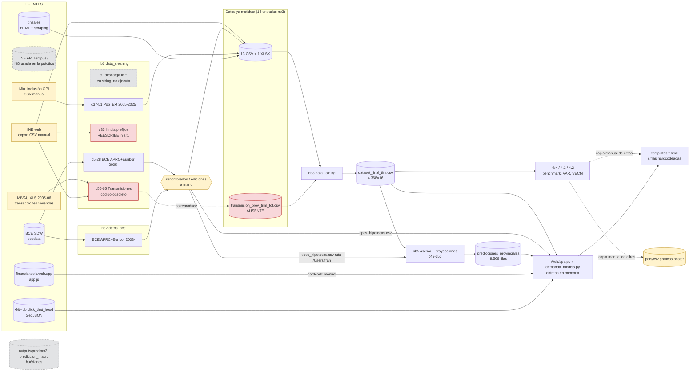

# 05 · Auditoría de Data Engineering

**Alcance:** linaje real de los datos (de la fuente a la app Flask), coherencia de las cifras publicadas, procesos de extracción, modelos serializados, reproducción aislada del notebook 3 y propuesta de arquitectura ETL v2.
**Fecha de la auditoría:** 2026-11-21. **Rama:** `claude/stoic-edison-gdie8p` (HEAD `6b418c6`). **No se ha modificado ningún fichero del proyecto.**

Evidencias reproducibles en `reports/audit/05_scratch/`:

| Script | Qué hace |
|---|---|
| `dump_notebooks.py` | Vuelca las celdas de todos los notebooks a `.py` numerados por celda (solo lectura) |
| `repro_nb3.py` | Reproduce el notebook 3 en un directorio aislado y compara columna a columna con `dataset_final_tfm.csv` (`--with-transm --keep-uniprov` reconstruye antes el fichero de transmisiones que falta) |
| `repro_nb5_forecasts.py` | Reproduce las celdas 49 y 50 del notebook 5 (proyecciones) y las compara con `predicciones_provinciales_2026_2030.csv` |
| `check_hipotecas_parsing.py` | Cuantifica el error de parseo de `Hipotecas_Total` y lo contrasta con la API del INE (`--api`) |
| `runtime_mape.py` | Calcula las métricas que la app calcula en runtime (`demanda_models._train_artifacts`) sin arrancar Flask |
| `trace_figures.py` | Rastrea cada cifra del README por código, salidas guardadas de los notebooks y plantillas |
| `verify_counts.py` | Verifica filas, provincias, trimestres, NaN, granularidad efectiva y el recuento del CSV de proyecciones |

Las copias temporales y las descargas (INE, BCE, financialtools) se dejaron en el scratchpad de la sesión, no en el repo.

---

## 0. Resumen ejecutivo

1. **CRÍTICA. La variable objetivo `Hipotecas_Total` está corrompida.** El CSV de entrada guarda los miles como float truncado (`"17.49"` significa 17.490 hipotecas), y `limpiar_numero` (nb3, celda 8) solo reconoce el patrón `\.ddd$`. Afecta a 414 de 13.104 filas mensuales, a **375 de 4.368 provincia-trimestres (8,6 %)** y a 39 provincias, con un sesgo medio del **−38 %** en esas celdas. El total nacional queda infraestimado entre un 0 % y un 19,7 % según el trimestre (−6,6 % de media). Contrastado con la API del INE (tabla 3200; series HPT34906 Madrid, HPT34927 Barcelona, HPT34934 Alicante). Arrastra todos los modelos de demanda (RF_Nac con "7,11 %", VAR/VECM, FEVD "53,3 %"), la serie del póster y el dashboard.
2. **CRÍTICA. El dataset maestro no se puede reconstruir desde el repositorio.** `transmision_prov_trim_tot.csv` no existe y el código del notebook 1 que lo debía generar no produce el fichero usado. Ese código espera la columna "Naturaleza de la finca", un triple mojibake y excluye las CCAA uniprovinciales, mientras que el CSV del repo es otra tabla del INE ("Viviendas: Total", ISO-8859, 2007M01–2026M02). Sí lo he **reconstruido con exactitud** (14/14 columnas, diferencias < 5e-13) cambiando una regla que no figura en el código: conservar las 7 CCAA uniprovinciales del XLS 2005–2006. Las salidas guardadas en el notebook 3 (celdas 20 y 23, por ejemplo Ávila 2025Q2 = 11.076) **no coinciden con el CSV commiteado** (698).
3. **ALTA. Rupturas de serie por empalme de estadísticas distintas.**
   - `Pob_Ext`: Padrón INE (2005–2022) + documentos de residencia del Ministerio de Inclusión (2023–2025). Mediana +28,7 % en 2023 y hasta +101 % en alguna provincia.
   - `Transmisiones_Total`: transacciones notariales del MIVAU (2005–2006) + ETDP del INE (2007–2025).
   - `Indice_Materiales`: media sin ponderar de 14 subíndices (7 materiales × 2 áreas) con bases distintas.
4. **ALTA. Reproducibilidad nula de la extracción.** La descarga INE del notebook 1 está comentada dentro de un string y tiene un error de sintaxis. Todos los CSV del INE son exportaciones manuales de la web. El euríbor "fixed", el spread "trim" y `tipos_hipotecas.csv` son renombrados y ediciones a mano. Las rutas son absolutas de macOS. No hay fecha de descarga, hash ni versión. Los mojibakes de 3 y 4 capas se explican por la celda 33 del notebook 1, que reescribe los ficheros *in situ* (lee latin-1, escribe UTF-8) cada vez que se ejecuta.
5. **ALTA. La app mezcla datos reales con supuestos hardcodeados.** El CSV de proyecciones incluye filas 2025 rellenadas hacia delante, con Euríbor = 2,50 e IPC = 2,80 fijos, mientras que lo real es 2,223 y 2,619. `/api/data` las concatena con los datos reales de 2025. Resultado: el gráfico de Euríbor muestra 2,30 en 2025Q2 cuando el real es 2,10.
6. **MEDIA. Cifras del README y de las plantillas sin trazabilidad o desalineadas** (sección 3). Ejemplos: el benchmark "~18/20/22/25/30/35 %" no coincide con ninguna salida; "8.320 filas" frente a 9.568 reales; el 7,11 % está hardcodeado, mientras que la app calcula 6,30 % en runtime.

---

## 1. Mapa de dependencias real

### 1.1 Diagrama (linaje observado, no el declarado)



### 1.2 Orden real de ejecución

Inferido de los nombres de ficheros que lee y escribe cada paso. Los `execution_count` no son fiables porque la mayoría de las celdas de nb1/nb2 tienen `None`.

1. **Descarga manual** desde la web del INE de las tablas 3199, 76136 (u otra de IPC), 8377, 8381, 6150, 3200, 2852/67988 y de la EPA. El código de descarga por API (nb1, celda 1) está dentro de un string y tiene un error de sintaxis en la última línea. Los IDs existen hoy en la API: los he verificado con `DATOS_TABLA/{id}?nult=1`.
2. **nb1:**
   - Celdas 5–28: BCE desde 2005. Genera `APRC_hipotecas_nuevas_men.csv`, `APRC_hipotecas_trimestral.csv`, `tipos_combinados_hipotecas.csv` y `spread_hipotecas.csv`.
   - Celda 33: limpieza *in situ* de 5 CSV.
   - Celdas 37–51: `pob_ext_provincias_2005_2025.csv`.
   - Celdas 55–65: `transmision_prov_trim_tot.csv`. Es una versión antigua: no se puede ejecutar con los ficheros actuales.
3. **nb2:** repite nb1 desde 2003 y escribe `spread_hipotecas_euribor.csv`. Ningún notebook escribe un CSV de euríbor.
4. **Pasos manuales no documentados:**
   - `euribor_trim.csv` (sin columna de fecha, en `Datos sucios/`) pasa a `euribor_trim_fixed.csv` (con `TIME_PERIOD` 2003-Q1…).
   - `spread_hipotecas_euribor.csv` pasa a `spread_hipotecas_trim.csv`.
   - `tipos_combinados_hipotecas.csv` pasa a `Web/static/tipos_hipotecas.csv`.
   - `tinsa_espana_precios.csv` pasa a `tinsa_prov_precios_trim.csv`.
   - Los INE `*_an.csv` / `*_men.csv` se renombran: nb1 c33 los llama `edad_media_provincias.csv`, `hipotecas_por_prov.csv`, `ipc_ccaa.csv`.
5. **nb3** escribe `dataset_final_tfm.csv` (en el cwd; se commitea en `notebooks acabados/`).
6. **nb4, 4.1 y 4.2** leen `dataset_final_tfm.csv` por nombre pelado. nb4 descarga el GeoJSON de GitHub. 4.2 escribe PNG `vecm_0*.png`, que no están en el repo.
7. **nb5:**
   - Celda 3 lee `/Users/fran/Documents/Proyectos máster/TFM/Web/static/tipos_hipotecas.csv` (ruta absoluta).
   - Celda ~41 escribe `proyecciones_demograficas_2030.csv` (1.092 filas, no está en el repo ni lo consume nada).
   - Celda 49 escribe `predicciones_provinciales_2026_2030.csv` (8.320 filas).
   - Celda 50 la reescribe con 9.568 filas. Su `exec_count` es `None`, pero el CSV commiteado ya tiene 9.568 filas: el fichero procede de una ejecución distinta a la guardada.
8. **nb6:** documentación de la web. Lee `../dataset_final_tfm.csv`, `../tipos_combinados_hipotecas_trim.csv` (inexistente) y `Web/static/style.css`, rutas incompatibles entre sí.
9. **App Flask:**
   - `DATASET_PATH` busca primero `<repo>/dataset_final_tfm.csv`, después `notebooks acabados/` y después `UPLOAD_FOLDER`.
   - Lee `Web/static/tipos_hipotecas.csv` y `notebooks acabados/predicciones_provinciales_2026_2030.csv`.
   - Entrena RF/GBR/SARIMAX en memoria la primera vez que se pide cada endpoint (no al arrancar).
10. **Manual:** cifras copiadas a plantillas, al póster (`pdfs/csv graficos poster`), a `custom_charts/index.json` (generado en runtime desde el editor de admin) y a `_mapa_cache_tension.b64` (caché en disco que nunca se invalida).

### 1.3 Tabla de ficheros: productor, consumidor y estado

| Fichero | Productor | Consumidor | Estado |
|---|---|---|---|
| `Datos sucios/APRC_hipotecas_nuevas_men.csv` | nb1 c7 (BCE `MIR.M.ES.B.A2C.A.C.A.2250.EUR.N`, desde 2005) | nb1 c10 | OK. Coincide al 100 % con la API del BCE actual (252 meses) |
| `Datos sucios/APRC_hipotecas_trimestral.csv` | nb1 c16 | nb1 c26 → `tipos_hipotecas.csv` | OK |
| `Datos sucios/euribor_trim.csv` | nb1 c18–22, sin fecha (guardado manual) | manual → `euribor_trim_fixed.csv` | Intermedio manual |
| `Datos sucios/pib_pc_prov.xlsx` | manual (INE CRE) | nadie (sí `Datos ya metidos/pib_pc_prov_an.xlsx`) | Huérfano / versión previa |
| `Datos sucios/pob_ext_2005_2022.csv` | manual INE Padrón | nb1 c37 | OK |
| `Datos sucios/pob_ext_2023_2025.csv` | manual Min. Inclusión (OPI) | nb1 c40 | Estadística distinta (ruptura) |
| `Datos sucios/transmisiones propiedades 2005-2006.xls` | manual MIVAU | nb1 c59 | Estadística distinta a la ETDP |
| `Datos ya metidos/euribor_trim_fixed.csv` | **manual** (BCE `FM.Q.U2.EUR.RT.MM.EURIBOR1YD_.HSTA` desde 2003) | nb3 | Sin productor en código. 8 trimestres difieren hoy del BCE hasta en 0,012 p.p. (revisiones/vintage) |
| `Datos ya metidos/spread_hipotecas_trim.csv` | nb2 c26 (`spread_hipotecas_euribor.csv`) renombrado | nb3 | Verificado = APRC − Euríbor (dif. máx. 8e-16) |
| `Datos ya metidos/tasa_ahorro_trimestral_nac.csv` | **desconocido** (INE CNTR, tabla no documentada) | nb3 | Sin trazabilidad |
| `Datos ya metidos/tinsa_prov_precios_trim.csv` | `tinsa_scraper.py` (salida `tinsa_espana_precios.csv`, renombrado) | nb3 | 52 prov. × 100 trimestres (2001T1–2025T4) |
| `Datos ya metidos/hipotecas_por_prov_men.csv` | manual INE 3200 | nb3 | **Corrupto** (formato numérico, §4 H1) |
| `Datos ya metidos/poblacion_por_prov_combinado.csv` | manual INE 2852 + 67988 ("combinado" a mano) | nb3 | Mojibake de 4 capas |
| `Datos ya metidos/edad_media_provincias_an.csv` | manual INE 3199 | nb3 | Mojibake de 3 capas |
| `Datos ya metidos/pib_pc_prov_an.xlsx` | manual INE | nb3 | 2005–2024; 2025 NaN |
| `Datos ya metidos/indice_mano_obra_men.csv` | manual INE 8377 | nb3 | Termina en 2025M03; la API tiene hasta 2025M05 (IMM1) |
| `Datos ya metidos/indice_precio_materiales_men.csv` | manual (antigua base, 7 materiales × 2 áreas) | nb3 | Termina en 2025M03; la tabla 8381 actual es base 2011, 16 materiales, hasta 2026M03 |
| `Datos ya metidos/ipc_ccaa_men.csv` | manual INE (variación anual, índice general) | nb3 | OK. "IPC" es tasa interanual, no índice |
| `Datos ya metidos/epa_prov.csv` | manual INE EPA | nb3 | OK (Ambos sexos, 84 trimestres) |
| `Datos ya metidos/pob_ext_provincias_2005_2025.csv` | nb1 c51 | nb3 | Ruptura en 2023 |
| `Datos ya metidos/transmision_propiedades_prov.csv` | manual INE 6150 ("Viviendas: Total") | **nadie directamente** (nb1 c55 espera otra tabla) | Insumo real (reconstruido) del fichero ausente |
| `transmision_prov_trim_tot.csv` | nb1 c65 (código obsoleto) | nb3 c17 | **AUSENTE**. nb3 traga el error (`try/except` + print) |
| `notebooks acabados/dataset_final_tfm.csv` | nb3 c22 | nb4, 4.1, 4.2, nb5, app, gen_charts | Reproducido (§5) |
| `notebooks acabados/predicciones_provinciales_2026_2030.csv` | nb5 c49 + c50 | app (`df_prov_preds`, `demanda_models`) | 9.568 filas; reproducido con tolerancias (§6) |
| `notebooks acabados/benchmark_provincial_chart.png` | ningún `savefig` lo nombra | nadie | Huérfano |
| `notebooks acabados/pdfs/*.pdf` | exportaciones manuales (vertopal.com) | nadie | Derivados, no fuente |
| `pdfs/csv graficos poster/*.csv` (8) | **manual** (ningún código) | póster (fuera del repo) | `data_benchmark_mape.csv` con valores redondos sin origen; `data_serie_historica.csv` hereda el error de Hipotecas |
| `outputs/preciom2/*` y `outputs/prediccion_macro/*` | **ningún notebook ni script presente** | nadie | Huérfanos. LightGBM / Ridge / RF, distintos del Holt-Winters del README |
| `web scrapping/datos_fiscales_scraped/*.csv` | `scraping_finantialtools.ipynb` (todas las celdas `exec=None`) | nadie (app y nb5 tienen copias hardcodeadas) | Huérfanos; ITP tecleado a mano (§4 H10) |
| `web scrapping/tinsa.html` | guardado manual (provincia de Salamanca) | `tinsa_scraper.py` (ruta absoluta Mac) | Snapshot sin fecha |
| `Web/static/tipos_hipotecas.csv` | nb1 `tipos_combinados_hipotecas.csv` copiado a mano | app, nb5 c3 | APRC idéntico a `Datos sucios` (84/84) |
| `Web/static/_mapa_cache_tension.b64` | app `/api/mapa/tension` en runtime (PNG base64, 59.782 B) | app | Caché commiteada que **nunca se invalida** (el comentario dice que sí) |
| `Web/static/custom_charts/index.json` | editor de admin (runtime, 2026-03-02) | app | 3 gráficos; valores coherentes con el dataset actual (Madrid 2.603,85 €/m², media 2005–2025) |
| `Web/static/img/econometria/*.png` | `Web/gen_charts.py` | `econometria.html` | `gen_charts.py` lee `<repo>/dataset_final_tfm.csv`, que no existe: hoy no se regeneran |
| `Web/static/spain-provinces.geojson` | descarga de GitHub (click_that_hood) | app | Licencia sin documentar |

**Scripts obsoletos** (comprobado que sus cadenas objetivo ya no existen en `app.py` ni en `demanda_models.py`):

| Script | Situación |
|---|---|
| `fix_app.py` | Busca "# ── 6. Forecast 5 años 2026-2030" → 0 coincidencias |
| `patch_app_demanda.py` | Busca `projections = {2026: 622409…` → 0 coincidencias. Contenía proyecciones **hardcodeadas** de demanda |
| `patch_demanda.py` | Objetivo inexistente |
| `update_nav.py` | Ya aplicado: el enlace `/econometria` está en 11 plantillas |
| `add_doc_notebooks.py` | Apunta a `HIPOTECA_PERSONALIZADA.ipynb` y `pasos_web.ipynb`, nombres ya inexistentes |
| `test_api.py` | Smoke test sin aserciones, no es pytest |
| `gen_charts.py` | Vigente pero roto por la ruta. Usa `bfill`, que rellena el pasado con valores futuros |

**Duplicados:** nb1 (celdas 3–28) y nb2 son el mismo flujo BCE con distinto inicio (2005 frente a 2003) y distinto nombre de salida (`spread_hipotecas.csv` frente a `spread_hipotecas_euribor.csv`). El insumo real de nb3 sale de nb2.

---

## 2. Coherencia de cifras básicas (verificadas)

Comandos: `verify_counts.py`, `repro_nb3.py`, `repro_nb5_forecasts.py`.

| Cifra declarada | Verificación | Veredicto |
|---|---|---|
| 52 provincias | 52 únicas, 0 duplicados de clave | ✔ (50 provincias + Ceuta y Melilla; mejor llamarlo "52 unidades territoriales") |
| 84 trimestres | 2005-01-01 → 2025-10-01 = 84 | ✔ |
| 4.368 observaciones | 52 × 84 = 4.368 filas | ✔ como filas provincia-trimestre. No son 4.368 observaciones independientes: 5 variables son nacionales (1 valor por trimestre), IPC es autonómico (19 valores) y PIB_pc, Población, Edad media y Pob_Ext son anuales repetidas (1 valor por provincia-año) |
| "52 provincias × 20 años ≈ 4.368" (nb3, celda 0) | Son 21 años | ✘ texto |
| "Periodo 2005–2030" | Histórico 2005Q1–2025Q4; 2026–2030 son proyecciones; las filas 2025 del CSV de proyecciones son forward-fill | ✘ engañoso: debe separarse "observado 2005–2025" y "proyectado 2026–2030" |
| 8.320 filas de proyecciones | Celda 49 = 8 var × 52 × 20 = 8.320. Celda 50 añade 6 var × 52 × 4 (2025) = 1.248. **Total 9.568** = 6 × 52 × 24 + 2 × 52 × 20 | ✘ README desactualizado. El CSV contiene 2025 "proyectado" con Euríbor 2,50 e IPC 2,80 constantes (reales 2025: 2,223 y 2,619) |
| "14 fuentes de información" | Ver desglose a continuación | ✘ ambiguo: son **14 ficheros de entrada**, no 14 fuentes |
| "Series anuales expandidas por interpolación" | Replicadas (1 valor por provincia-año) | ✘ |
| "Mensuales agregadas por media trimestral" | Hipotecas suman; materiales, mano de obra e IPC promedian; transmisiones suman | ✘ parcial |
| NaN | PIB_pc 208 (todo 2025), Materiales y Mano de obra 156 (2025Q2–Q4), tasa_ahorro 52 (2025Q4) | ✔ coincide con el briefing. Los huecos de materiales y mano de obra son por fecha de descarga: el INE publica más meses |

**Recuento de fuentes:**
- **Ficheros integrados en nb3: 14.**
- **Series o ficheros primarios: 18.** Los 14 anteriores + APRC y Euríbor como series BCE separadas (+1) + Pob_Ext 2 ficheros (+1) + Transmisiones 2 ficheros (+1) + `tipos_hipotecas.csv` para la app (+1).
- **Organismos o publicadores del panel maestro: 5.** INE, BCE, Tinsa, Ministerio de Vivienda (MIVAU; XLS 2005–06; los índices de materiales y mano de obra se descargaron vía INE), Ministerio de Inclusión (OPI).
- **Organismos para toda la plataforma: 8.** Los 5 anteriores + financialtools.web.app (tercero no oficial), escenarios BCE hardcodeados y GeoJSON de GitHub.

Recomendación: publicar el catálogo `sources.yaml` y decir "N series de M organismos".

---

## 3. Trazabilidad de cifras del README, `Web/README.md` y plantillas

Origen: **R** = calculada en runtime por la app; **N** = salida guardada de un notebook (cuál); **H** = hardcodeada en texto o plantilla; **∅** = sin origen localizado.

| Cifra (dónde aparece) | Origen real | Comentario |
|---|---|---|
| RF_Nac MAPE **7,11 %** (README; `business_case`, `econometria`, `webscrapping`, `metodologia_ml`.html) | N: nb4 c20/22/28/35/54/71 (RMSE 12.513, R² 0,3995). H en plantillas | La app calcula en runtime **6,30 %** (R² 0,477) con su propio RF_Nac (`runtime_mape.py`). Ambas sobre una `Hipotecas_Total` corrupta. Test de 8 trimestres |
| Benchmark "RF ~18 %, XGB ~20 %, LGBM ~22 %, GBM ~25 %, ElasticNet ~30 %, SARIMAX ~35 %" (README; `data_benchmark_mape.csv`) | **∅** | Salidas reales de nb4: provincial RF 16,75 / XGB 19,87 / LGBM 20,22 / GBM 21,51 / ElasticNet 49,21 (c71); SARIMAX nacional 16,57 (c22). Mezcla de métricas provinciales y nacionales |
| VECM: β 0,35 / 2,48 / −0,10 / −1,09; α −0,44 / −0,006 (README; `vecm.html`; contexto de chat en `app.py` l.1841–1844 y 2253–2255) | N: nb4.2 c7 y c8. H en plantillas y prompts | Semividas verificadas: ln 0,5 / ln(1−0,44) = **1,2 trim.**; α = −0,006 da **28,8 años** (README dice "30 años") |
| FEVD h = 20: 53,3 % / 38,8 % / 2,6 % / 2,2 % / 3,0 % | N: nb4.2 c14. H en `vecm.html`, `business_case.html`, `app.py` | Coincide con la salida. Heredan el error de Hipotecas |
| VAR corto plazo 70,3 % / 18,1 % / 11,5 % (`econometria.html`, `app.py`) | ∅ en las salidas guardadas | No localizado en ninguna salida |
| Tabla de paro 12,9 / 12,9 / 16,9 / 15,7 %; U2 0,545 / 0,713 / 1,032 / 0,944 | N: nb5 c51 | README dice nivel 1 = "SARIMA(1,0,0)(1,0,0)₄"; el código usa (1,1,0)(1,1,0)₄ y (1,1,0)(0,0,1)₄. El comentario del código dice "19 provincias" y el set tiene 17 |
| PIB MAPE 7,2 %, U 0,749 | N: nb5 c51 | ✔ |
| Precio_m2 MAPE 2,9 %, U2 **0,634** | N: nb5 c51 dice **0,637** | Discrepancia menor |
| HW gana en el **79 %**; φ ≈ 0,94; CAGR 2,24 %; ADF p = 0,989; paro mínimo 7,95 % | Solo en markdown (nb4.1, nb5 md47) y H en `hipotecas.html` y `metodologia_ml.html` | **∅** en salidas de código |
| "MAPE del 0.6 %" (`hipotecas_provincial.html`); 74 %, 0,8 % (`hipotecas.html`, `metodologia_ml.html`) | H | Sin origen localizado |
| Badajoz "MAPE 20,6 % → 7,3 %" (`app.py` l.249) | H; el 7,3 % está en nb5 c51 | El 20,6 % no está en ninguna salida guardada |
| "app.py 2.442 líneas" (`Web/README`) | `wc -l` = 2.442 | ✔ (README raíz dice ">2.200") |
| "PROVINCE_TO_CCAA: 52 provincias" (`Web/README`) | 53 claves, pero **12 provincias del dataset no casan** (A Coruña, Álava, Almería, Ávila, Cáceres, Cádiz, Castellón, Córdoba, Guipúzcoa, Jaén, León, Málaga) | `_get_ccaa` devuelve `""` → se aplican tipos fiscales por defecto |
| Aranceles "extraídos del RD 1426/1989" (`Web/README`) frente a "scrapeados de financialtools" (README raíz, notebook) | H | Origen contradictorio. Los valores coinciden con `app.js` de financialtools |
| AJD por CCAA (app, CSV scraped) | H | `app.js` actual difiere en 4 CCAA: Canarias 1,0→0,75; Cantabria 1,5→1,0; Castilla-La Mancha 1,25→1,5; Extremadura 1,2→1,5. Sin snapshot ni fecha. La fuente tampoco es oficial |
| Euríbor 2026–2030 (2,00 / 2,10 / 2,30 / 2,15 / 2,15), IPC (1,88 / 2,10 / 2,00…) | H en nb5, `app.py` y `demanda_models.py` (3 copias) | Sin cita de la publicación del BCE ni de la fecha (vintage) |
| Euríbor 2025 = 2,50; IPC 2025 = 2,80 (nb5 c50) | H, con el comentario "valores reales observados" | **Falso**: dataset 2025 da Euríbor 2,223 e IPC 2,619 |

---

## 4. Hallazgos por gravedad

### CRÍTICA

**H1. Corrupción de `Hipotecas_Total` (target principal).**
- Evidencia: `check_hipotecas_parsing.py --api`. En el CSV, Madrid 2005M05 = `17.49`; la API del INE (HPT34906) da 17.490.
- Formatos en el CSV: 8.939 valores `X.0`, 3.751 `X.ddd` y **414 `X.d`/`X.dd`**. Estos últimos son miles con ceros finales truncados, que nb3 lee como decimales.
- Impacto en el maestro: 375 provincia-trimestres (8,6 %), 39 provincias. Las más afectadas son Barcelona (26 trimestres), Madrid (22), Alicante y Valencia (20). Sesgo medio en las celdas afectadas: −38 %. Total nacional: −6,6 % de media y −19,7 % como peor caso.
- Tras corregir el parseo, las únicas diferencias con la API son revisiones de 2025 (provisional → definitivo) y un caso ambiguo `"1.0"` = 1.000 en Alicante 2013M12.
- Arrastra:
  - todos los modelos de demanda (nb4, RF de la app), el VAR/VECM y la FEVD;
  - el póster (`data_serie_historica.csv`: 2005-01 = 373,4 mil, valor corrupto);
  - el dashboard y el mapa "mina de oro".
- Remedio: reingestar desde la API (tabla 3200, `Valor` numérico) y nunca reparsear texto con formato español. Recalibrar todo lo que use `Hipotecas_Total`.

**H2. Dataset maestro no reconstruible desde el repo (transmisiones).**
- `transmision_prov_trim_tot.csv` está ausente y nb3 traga el error.
- El código de nb1 (c55–65) no corresponde al insumo usado: otra tabla, otra codificación y exclusión de las CCAA uniprovinciales.
- Reconstrucción exacta posible con `repro_nb3.py --with-transm --keep-uniprov`. Requiere una regla no documentada: mantener 'Madrid (Comunidad de)', 'Asturias (Principado de)', etc. del XLS. Sin ella faltan 56 valores (7 provincias × 8 trimestres de 2005–2006).
- Las salidas guardadas de nb3 (c20/c23) muestran un `Transmisiones_Total` distinto al CSV commiteado (Ávila 2025Q2 11.076 frente a 698; Zaragoza 2025Q4 4.722 frente a 3.274). La versión antigua contaba todas las fincas; la actual, solo viviendas. **El notebook commiteado no describe el dataset commiteado.**

### ALTA

**H3. Rupturas de serie por empalme de estadísticas distintas.**
- `Pob_Ext`: Padrón INE hasta 2022 + "residentes con documentación" del OPI desde 2023. La variación interanual mediana pasa de +1,9 % (2022) a +28,7 % (2023), con un máximo de +101 %. Total nacional: 5,54 M → 6,71 M (+21 %). Además, 2025 es la media de solo 3 trimestres.
- `Transmisiones_Total`: MIVAU (notarial, viviendas) en 2005–06 y ETDP del INE (registral) desde 2007.
- `Indice_Materiales`: media sin ponderar de 7 materiales × 2 áreas ("Península y Baleares" y "Canarias"), cada uno con su propia base. No es un índice oficial.
- Recomendación: series homogéneas (por ejemplo, ECP o Padrón del INE para extranjeros, si existe cobertura 2023–2025; *a verificar por el agente de fuentes*), dummies de ruptura o recorte de periodo, e índice general oficial de la tabla 8381 base 2011.

**H4. Extracción no automatizada ni trazable.**
- Descarga INE comentada y rota. Exportaciones manuales en formato web (`;`, `Total` con formato español).
- 4 renombrados o ediciones manuales. Rutas absolutas `/Users/fran/...` en nb1 c1, nb5 c3 y `tinsa_scraper.py`. Notebooks dependientes del cwd con rutas incompatibles (nb6).
- Sin fecha de descarga, id de serie, hash ni vintage: no se puede distinguir revisión de error. Ejemplos: el Euríbor difiere hoy del BCE en 8 trimestres (hasta 0,012 p.p.) y las hipotecas 2025 han sido revisadas por el INE.

**H5. Escritura *in situ* destructiva (nb1 c33).**
- Lee en latin-1 y escribe en UTF-8 sobre el mismo fichero. Cada ejecución añade una capa de mojibake.
- Observado: población 4 capas, edad media 3, el CSV de transmisiones antiguo 3. nb3 lo "resuelve" con heurísticas frágiles (`'cer' in x and 'C' in x → Cáceres`, *fuzzy matching* con cutoff 0,5).
- Hoy funciona por casualidad; cualquier provincia nueva o renombrada puede emparejarse mal sin aviso.

**H6. Errores silenciados.** nb3 envuelve cada fuente en `try/except: print(...)`. Si falta un fichero, el maestro sale con una columna menos y no falla (lo he reproducido: 15 columnas). No hay validación de esquema, rangos ni recuentos.

**H7. Contaminación 2025 en la app.**
- El CSV de proyecciones contiene 2025 como forward-fill desde 2025Q4 real (precio, paro, transmisiones), 2024 (PIB) y constantes 2,50 / 2,80.
- `/api/data` concatena esas filas con las reales: 104 filas por trimestre en 2025, el doble de las 52 esperadas.
- Euríbor mostrado: 2025Q1 2,473 (real 2,446), Q2 2,301 (real 2,102), Q3 2,310 (real 2,121), Q4 2,362 (real 2,224). IPC 2025 mostrado 2,709 frente a 2,619 real.

**H8. Admin sin validación ni coherencia de cachés.**
- `/admin` guarda cualquier CSV en `UPLOAD_FOLDER`, que es `abspath(dirname('__main__')/..)`, es decir, el padre del cwd. No usa `secure_filename` y no valida el esquema.
- El primer candidato de `DATASET_PATH` es `<repo>/dataset_final_tfm.csv`, así que un fichero subido puede **ensombrecer** silenciosamente el de `notebooks acabados/` en el siguiente arranque.
- No se invalidan `_ARTIFACTS`, `_MACRO_FORECASTS`, `_DEMANDA_CACHE` ni `_mapa_cache_*.b64`.
- (El riesgo de ejecución de código lo trata el agente de seguridad y software.)

### MEDIA

- **H9. Modelos no serializados y entorno sin fijar.**
  - No hay `.pkl` en el repo (`*.pkl` está en `.gitignore`). La app reentrena RF, GBR y SARIMAX en memoria en la primera petición, con `n_jobs=-1`.
  - `Web/requirements.txt` solo lista Flask, pandas, werkzeug, google-generativeai y python-dotenv. Faltan numpy, scikit-learn, statsmodels, shap, geopandas, matplotlib y **google-genai**: el código importa `from google import genai`, que no es `google-generativeai`.
  - Sin versiones fijadas. La reproducción de nb5 c49 con statsmodels 0.15 da PIB idéntico pero Holt-Winters y ARIMA distintos: Transmisiones con 0,48 % de diferencia media y 27 % de máxima; Precio_m2 con 0,07 % de media y 2,8 % de máxima.
- **H10. Datos fiscales "scrapeados" que en realidad están tecleados.**
  - En `scraping_finantialtools.ipynb`, ITP general y joven son diccionarios escritos a mano. Solo AJD y aranceles se extraen. Todas las celdas tienen `exec=None`.
  - Los CSV resultantes no los consume nadie: la app y nb5 tienen copias propias. La fuente es un tercero no oficial y el `app.js` actual ya difiere en 4 tipos de AJD.
  - Las claves por CCAA cambian de formato: con tildes en `ajd_por_ccaa.csv`, sin tildes en `itp_por_ccaa.csv` y en la app. Esto contribuye a los 12 fallos de emparejamiento de `_get_ccaa`.
- **H11. Agregaciones nacionales sin ponderar.** `_build_forecasts` y `gen_charts` obtienen el PIB_pc "nacional" y el Precio_m2 como media simple de 52 provincias (Soria pesa igual que Madrid). `demanda_models` sí pondera algunas variables. Las definiciones son inconsistentes.
- **H12. Caché de mapa commiteada y nunca invalidada** (`_mapa_cache_tension.b64`). `gen_charts.py` está roto por la ruta, así que los PNG de econometría no se pueden regenerar sin mover el dataset.
- **H13. Huérfanos con resultados distintos a los documentados:** `outputs/*` (LightGBM / Ridge / RF), CSV del póster con valores redondos sin origen, `benchmark_provincial_chart.png`.
- **H14. Scraping de Tinsa:** `robots.txt` permite `/precio-vivienda/`. El scraper tiene `sleep(1)` y timeout de 10 s, pero no reintentos y usa un User-Agent de navegador falso. El descubrimiento depende de un `tinsa.html` guardado a mano sin fecha. El parseo es heurístico ("primer `data:[...]` con la misma longitud que las fechas y valores > 100"). Hay que revisar el aviso legal de Tinsa antes de redistribuir los datos derivados en el repo público.

### BAJA

- nb1 c1 usa `utcfromtimestamp` (obsoleto). El nombre de `CARPETA` es absoluto.
- `limpiar_numero` interpreta `"3.915"` como 3915 también en variables decimales (latente).
- Ordenación "hispana" manual, que sería innecesaria con un `prov_code`.
- `Trimestre` es texto `YYYY-MM-DD` en el maestro y `YYYY-MM` en las proyecciones (la app lo parchea con `+ "-01"`).
- `README.md` publica un email personal del autor (decisión del coordinador).
- GeoJSON de click_that_hood sin licencia documentada.

---

## 5. Reproducción aislada del notebook 3

Comando:

```
python reports/audit/05_scratch/repro_nb3.py <repo> <scratch>/nb3_X [--with-transm [--keep-uniprov]]
```

Copia `Datos ya metidos/` a un directorio temporal, ejecuta las celdas de nb3 tal cual con `exec` y compara con la referencia (pandas 3, Python 3.13).

| Variante | Resultado |
|---|---|
| A. Tal cual | Salida "Error cargando transmision_prov_trim_tot: No such file". Maestro de **4.368×15**. Las 13 columnas restantes son **idénticas** (0 diferencias, NaN iguales) |
| B. Transmisiones reconstruidas con la lógica de nb1 c59/61 sobre los ficheros actuales | 14/14 columnas, pero `Transmisiones_Total` tiene **56 NaN** (Cantabria, Navarra, Madrid, Baleares, La Rioja, Asturias y Murcia en 2005–2006). Ratio ref/nuevo = 1,000 en el resto |
| C. B + conservar las filas de CCAA uniprovinciales del XLS | **Idéntico**: 4.368×16, 0 diferencias por columna. Diferencias en bytes solo por redondeo de coma flotante (máx. 4,5e-13 en Precio_m2 / Materiales) |

**Conclusión:** el maestro es determinista y reproducible a partir de `Datos ya metidos/` + `Datos sucios/*.xls`, pero solo con una regla de transformación que no existe en el código. Y lo que reproduce incluye el error H1.

**Proyecciones (nb5 c49 + c50, `repro_nb5_forecasts.py`):** 9.568/9.568 filas emparejadas.

| Variable | Resultado |
|---|---|
| Euríbor, IPC, PIB_pc | Idénticos |
| Población, Pob_Ext | Diferencia media < 0,02 % |
| Precio_m2 | 0,07 % (máx. 2,8 %) |
| Tasa_Paro | 0,03 % |
| Transmisiones | 0,48 % (máx. 27 %) |

La diferencia se explica por la versión de statsmodels y el optimizador de Holt-Winters; no hay versiones fijadas.

---

## 6. Modelos serializados

- No existen `.pkl`, `.joblib` ni ficheros de modelo en el repo ni en el árbol de trabajo. `*.pkl` está en `.gitignore` y `catboost_info/` también se excluye.
- La app obtiene sus modelos **entrenándolos en memoria**:

| Componente | Modelos | Cuándo se entrena | Caché |
|---|---|---|---|
| `demanda_models._train_artifacts` | RF provincial 300 árboles + RF nacional 200, con evaluación sobre los últimos 8 trimestres | Primera llamada a `/api/data` o `/api/demanda-data` | Global `_ARTIFACTS` |
| `_build_forecasts` | SARIMAX y búsqueda ARIMA en rejilla (24 fits por variable) | Primera llamada | `_MACRO_FORECASTS` |
| `_train_ml_pricing_model` | GBR + SHAP por año | Por año pedido | — |
| `/api/mapa/mina_oro` | RF de 100 árboles | En cada petición si no hay caché en disco | Disco |

- Consecuencias:
  - Primera petición lenta.
  - Métricas que cambian con el entorno.
  - Imposibilidad de auditar "el modelo en producción".
  - Las métricas de runtime (6,30 % nacional, 14,71 % provincial, R² provincial 0,969) no son las que muestran las plantillas (7,11 %).
- Propuesta v2: artefactos versionados en `artifacts/<dominio>/` (JSON de métricas + modelo `skops`/`joblib` con hash del panel de entrenamiento), generados por `src/pipelines/`. La app solo **carga** y no entrena.

---

## 7. Arquitectura ETL v2 propuesta

Mantengo el contrato del briefing con cuatro ajustes:
1. **Staging long único** con esquema común, en lugar de un fichero por fuente con formato libre.
2. **Manifest por ejecución** además del manifest por snapshot.
3. Campo **`vintage`** (fecha de publicación o descarga) distinto de `period` (referencia).
4. **Parquet** en `staging` y `processed`, con CSV solo como exportación para el tribunal y la web.

### 7.1 Capas y contratos

```
data/raw/<source>/<dataset_id>/<YYYYMMDD>/   payload original (JSON API / CSV / XLS / HTML / JS) + meta.json
      meta.json = {source, dataset_id, series_ids[], url, params, http_status, retrieved_at (UTC),
                   sha256, bytes, licence, connector_version}
data/staging/<source>__<dataset_id>.parquet  formato LONG normalizado:
      prov_code (str "01".."52" | "00" nacional | "CCAA:xx"), geo_level, period ("YYYYQn" | "YYYY" | "YYYY-MM"),
      freq, variable, value (float64), unit, measure ("indice", "tasa", "nivel"...),
      source, dataset_id, series_id, vintage (fecha snapshot), raw_sha256, flags (provisional/estimado/revisado)
data/processed/panel_trimestral.parquet (+ .csv)  ancho, clave (prov_code, period); columnas con sufijo de origen
      cuando hay empalme (p.ej. pob_ext_padron / pob_ext_opi) + columna is_projection=False
data/processed/panel_anual.parquet         variables anuales SIN replicar (PIB_pc, Poblacion, Edad_Media, Pob_Ext)
data/forecasts/<run_id>/forecasts_long.parquet  con is_projection=True, model_id, train_end, scenario_id
data/metadata/sources.yaml | variables.yaml (diccionario, unidad, agregación temporal y espacial, ponderación)
            | provincias.csv (INE 01..52, nombre oficial, alias co-oficiales, CCAA) | fiscalidad.yaml (con vigencias)
            | manifests/<run_id>.json (inputs sha256 → outputs sha256, versiones de librerías, git sha)
```

### 7.2 Conectores (`src/ingestion/`), interfaz común

Interfaz `fetch(dry_run) -> RawSnapshot`, `parse(snapshot) -> DataFrame long`, `expected_schema`. Los ids de serie van en `sources.yaml`, no en el código.

| Conector | Fuente / ids | Notas |
|---|---|---|
| `ine.py` | API Tempus3 `DATOS_SERIE/{COD}` o `DATOS_TABLA/{id}?tip=AM` | Tablas 3200 (hipotecas), 6150 (ETDP), 3199 (edad media), 67988/2852 (población), EPA, IPC CCAA, CRE (PIB), 8377/8381 (MIVAU vía INE, base 2011), CNTR (tasa de ahorro, **id por documentar**). Usa `Valor` numérico, nunca el CSV web |
| `ecb.py` | `data-api.ecb.europa.eu` (CSV o SDMX) | `MIR.M.ES.B.A2C.A.C.A.2250.EUR.N`, `FM.Q.U2.EUR.RT.MM.EURIBOR1YD_.HSTA` (o mensual `FM.M…` agregado en código) |
| `inclusion.py` / `mivau.py` | Ficheros con URL y fecha | Fuentes sin API: snapshot del fichero manual registrado con `register_manual(path, url, retrieved_at)` |
| `tinsa.py` | HTML de `/precio-vivienda/<ccaa>/<prov>/` | Descubrimiento desde el sitemap (no desde un HTML guardado a mano). Reintentos con backoff, rate limit de 1 req/s, User-Agent identificable, guardado del HTML crudo y licencia |
| `fiscalidad.py` | Normativa autonómica | Fuente primaria (BOE y boletines autonómicos), con vigencias. financialtools solo como contraste, con snapshot de `app.js` + sha256 |
| `bde.py` / `eurostat.py` | Si se incorporan | — |

Todos los conectores aplican `requests.Session` con timeout (conexión 10 s, lectura 60 s), 3 reintentos con backoff exponencial para 429/5xx, `raise_for_status` y validación del tipo de respuesta. El INE devuelve a veces un string de error con HTTP 200, así que hay que comprobarlo.

### 7.3 Transformaciones y validación

- **`transformations/`:** agregación temporal declarada en `variables.yaml` (`sum` | `mean` | `last` | `annual_no_replicate`), mapeo geográfico por **código INE** (sin fuzzy matching; alias explícitos en `provincias.csv`) y empalmes explícitos con columna de origen y dummy de ruptura.
- **`validation/`** (pandera o reglas propias):
  - esquema y tipos;
  - unicidad de la clave;
  - cobertura esperada: 52 provincias × N periodos por fuente;
  - rangos por variable: hipotecas mensuales provinciales en [0, 30.000], tasas en [−5, 60], etc.;
  - **detector de formato numérico**: proporción de valores no enteros en conteos = 0, que habría detectado H1;
  - saltos interanuales > k·σ como aviso de ruptura;
  - reconciliación (siguiente punto).
- **Reconciliación:**
  - suma de provincias = total nacional publicado (hipotecas, transmisiones), con tolerancia del 0,5 %;
  - spread = APRC − Euríbor;
  - media mensual = trimestral del BCE;
  - reconteo frente a la versión previa (diff por celda).
  - El resultado va a `artifacts/data_quality/report_<run_id>.json` y lo consume la web.

### 7.4 Pipelines (`src/pipelines/`)

```
update_all.py   [--sources ine,ecb,...] [--dry-run] [--since YYYYMMDD]
    1. fetch → raw snapshot (sha256). Si sha256 == último snapshot → "sin cambios", no re-procesa.
    2. parse → staging; diff contra staging anterior → cambios por (serie, periodo): nuevo / revisado / igual.
    --dry-run: descarga a tmp, valida y emite el diff y el manifest SIN escribir en data/.
build_master.py [--rebuild]  staging → panel_trimestral/anual + validación + manifest (inputs→outputs hashes).
    --rebuild: borra staging/processed y reconstruye solo desde data/raw (prueba de reproducibilidad en CI).
generate_forecasts.py  panel → data/forecasts/<run_id> + artifacts/forecasting (métricas de backtest).
```

**Detección de cambios y qué recalibrar.** Una tabla `variables.yaml → consumers` dice qué modelos dependen de cada variable:

| Si cambia… | Recalibrar |
|---|---|
| `Hipotecas_Total` | Demanda (RF_Nac, RF provincial), VAR/VECM, FEVD, mapa "mina de oro" |
| `Precio_m2`, `Euribor`, `Spread` | Asesor GBR/SHAP, VECM, proyecciones de precio |
| `Tasa_Paro`, `PIB_pc`, `Poblacion`, `Pob_Ext`, `Transmisiones` | Proyecciones provinciales y features de demanda |
| Fiscalidad | Solo el asesor (sin reentrenar) |
| Escenarios BCE | Solo proyecciones (sin reentrenar) |

Solo se recalibra si cambia un valor en el periodo de entrenamiento. Si solo se añaden periodos nuevos, se reentrena y se registra el cambio de `train_end`.

### 7.5 Política de tamaño para git

Medidas actuales: `.git` = 18 MB. Ficheros más grandes del árbol: notebooks 4/5/4.2 (3,3 / 1,6 / 1,2 MB, por salidas con imágenes embebidas), PDFs (3,6 MB), `transmision_propiedades_prov.csv` (1,2 MB), `logo.png` (0,9 MB, marca a retirar), GeoJSON (0,8 MB).

| Se commitea | No se commitea |
|---|---|
| `data/metadata/**` (YAML, CSV pequeños, manifests) | `data/raw/**`: sí el `meta.json` + sha256 de cada snapshot, no el payload |
| `data/processed/panel_trimestral.csv` (≈0,8 MB) y `data/forecasts/latest/*.csv`, como entregables del TFM y para la web | `.parquet` intermedios de `staging` (se regeneran) |
| `artifacts/**/*.json` (métricas, FEVD, IRF, calidad) | Modelos binarios (`*.pkl`, `*.joblib`, `*.skops`) |
| Snapshots crudos de fuentes **sin API estable** (OPI, XLS MIVAU, HTML Tinsa, `app.js`), si caben en < 5 MB por fichero y la licencia lo permite | Salidas de notebooks con imágenes: `nbstripout`, o guardar las figuras en `artifacts/figures/` |

- Payloads crudos y modelos binarios: release de GitHub o almacenamiento externo, enlazado desde el manifest.
- **Git LFS: no lo recomiendo.** El volumen total es inferior a 50 MB, LFS complica clonar y la CI de GitHub Pages, y la reproducibilidad se garantiza por hash más reconstrucción desde las APIs. Solo valdría la pena si los snapshots crudos manuales superan unos 50 MB, y en ese caso mejor una release de GitHub con assets.
- Línea base v1: `Datos sucios/`, `Datos ya metidos/`, `notebooks acabados/`, `outputs/` y `web scrapping/` se conservan intactos según el briefing. En v2 se referencian desde `sources.yaml` como `legacy_v1` para las comparaciones antes/después.

---

## 8. Decisiones que requieren arbitraje

1. **Hipotecas_Total (H1):** ¿reingesta desde la API con revisiones 2025 actuales (vintage nuevo), o corrección mínima del parseo sobre el CSV v1 para aislar el efecto del bug en la comparación antes/después? Propongo ambas: v1-fixed para la comparación y v2 desde la API como oficial.
2. **Pob_Ext 2023–2025:** ¿buscar una serie INE homogénea, mantener el empalme con dummy, o truncar en 2022?
3. **Transmisiones 2005–2006 (MIVAU):** ¿mantener el empalme (con dummy) o empezar la serie en 2007 (panel 2007–2025, 76 trimestres)?
4. **`Indice_Materiales`:** ¿sustituir por el índice general oficial (tabla 8381, base 2011, con cobertura hasta 2026)?
5. **Filas 2025 del CSV de proyecciones:** eliminarlas (2025 es observado) y retirar los 2,50 / 2,80 hardcodeados.
6. **Fiscalidad:** fuente primaria normativa con vigencias frente a la calculadora de terceros.
7. **Tinsa:** confirmar las condiciones de uso antes de commitear HTML o datos derivados en el repo público.
8. **Cifras del README y plantillas:** que todas se generen desde `artifacts/*.json`. Eliminar las "~18/20/22/25/30/35 %" sin origen y el 7,11 % hardcodeado.
